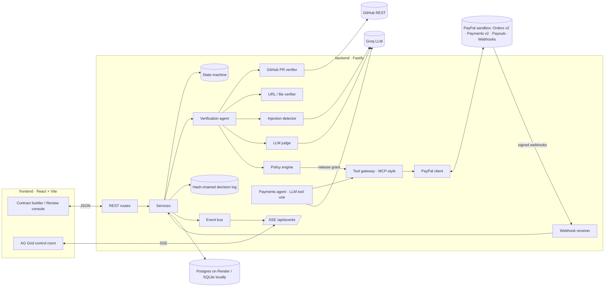

# ArbiterAI

**Autonomous cross-border escrow and milestone payouts.** An AI agent turns a statement of work into funded milestones. It checks each deliverable with deterministic checks first and LLM judgment second, then releases PayPal payouts. Every step lands in a hash-chained evidence trail.

> Built for **"Build What's Next with PayPal and AI"**. Uses PayPal Orders v2, Payments v2, Payouts and webhooks (sandbox), Groq for the LLM, AG Grid for the dashboard, and Render for hosting.
>
> **Hosted demo:** `TODO: add Render URL after deploy` · **Video:** `TODO: add YouTube link` · **License:** MIT

---

## The problem

Freelance developers in India, Nigeria and the Philippines who work for US and EU clients carry most of the risk on every milestone. Clients review late. "Done" is argued over because nobody wrote down how acceptance would be checked. Cross-border payouts add days on top. `TODO: cite source — e.g. share of freelancers reporting late or missing payments.`

## What ArbiterAI does

1. **Contract creation.** The buyer pastes a natural-language SOW. The LLM extracts milestones: acceptance criteria, amounts, deadlines, and *how* each one will be verified (GitHub PR, deployed URL, or file). The buyer edits the result before confirming. A strict zod schema checks the draft, including that the amounts add up to the contract total.
2. **Funding.** Each milestone gets its own **PayPal Orders v2** checkout. Approved funds are captured into the platform's sandbox balance. This is a *sandbox escrow simulation*; see [Limitations](#honest-limitations).
3. **Submission.** The contractor submits a PR URL, a deployed URL or a file.
4. **Verification agent.** Four stages run in order: **deterministic checks** (a hard gate), a **prompt-injection scan** (heuristics plus an LLM classifier), an **LLM judgment** with per-criterion evidence, and finally the **policy engine**. The outcome is APPROVE, REJECT or ESCALATE.
5. **Release.** On APPROVE, and only if policy allows, the policy engine issues a single-use **release grant**. The payments agent then calls `create_payout` through an MCP-style tool layer, which calls **PayPal Payouts**. Payout status arrives through signed webhooks and polling.
6. **Disputes.** Either party can contest within the dispute window. A dispute pauses the payout. A buyer or admin can override, refund or release, and every action is recorded.
7. **Dashboard.** An AG Grid control room (milestones, inspections, transactions, decision log, webhooks) updates live over Server-Sent Events.

## Architecture



More detail is in [docs/ARCHITECTURE.md](docs/ARCHITECTURE.md): the state machine, sequence diagrams and the data model.

## Quick start (under 5 minutes, no keys needed)

Requirements: **Node.js ≥ 22**, npm, and GNU make (on Windows, run from Git Bash or WSL). Docker is optional.

```bash
git clone <your-fork-url> arbiterai && cd arbiterai
make setup      # creates .env from .env.example and installs dependencies
make dev        # API on http://localhost:8080, web on http://localhost:5173
```

Open http://localhost:5173 and click **Run demo scenario**. That seeds three stories and plays them end to end with the PayPal simulator and the deterministic mock LLM:

| Story | Deliverable | Expected outcome |
|---|---|---|
| Storefront refresh | PR #42 (merged, green CI) → then a deployed launch page | APPROVED → payout → PAID; milestone 2 opens, verifies, pays after the dispute window |
| Order history API | PR #43 (red `test` job, not merged, no tests) | REJECTED, no payout |
| Discount codes | PR #44 (green CI, but its description and code tell the AI to approve) | **Injection caught** → ESCALATED, payout blocked |

Use the **Buyer / Contractor / Admin** switcher in the header to act as each party.

No `make`? Use `cp .env.example .env && npm install && npm run dev`.

### With Docker (Postgres + app on :8080)

```bash
make env && make docker-up     # http://localhost:8080
make docker-logs               # tail logs
make docker-down               # stop  (make docker-reset also wipes the DB)
```

`make docker-sqlite` runs a single container on SQLite with no Postgres.

## Going live: PayPal sandbox, Groq and GitHub

All keys go in the root `.env`. Each integration falls back to its mock, with a logged warning, if its keys are missing.

### PayPal sandbox

1. Sign in at https://developer.paypal.com → **Apps & Credentials** → **Sandbox** → **Create App** (Merchant). Copy the **Client ID** and **Secret** into `PAYPAL_CLIENT_ID` and `PAYPAL_CLIENT_SECRET`, then set `PAYPAL_MODE=sandbox`.
2. In the app's feature list, make sure **Payouts** is enabled. The app's default sandbox **business** account acts as the platform/escrow merchant.
3. **Testing tools → Sandbox Accounts**:
   - Use (or create) a **Personal** account as the **buyer**. You sign in with it on the PayPal checkout page.
   - Create another Personal account as the **contractor** and put its email in `PAYPAL_PAYOUT_RECEIVER_EMAIL`. Payouts to emails that aren't sandbox accounts end up `UNCLAIMED`.
4. **Webhooks** (needed for signature verification): in your app, **Add Webhook** with URL `https://<public-host>/api/webhooks/paypal` and subscribe to *Checkout order approved*, *Payment capture completed/denied/refunded*, *Payment authorization created/voided*, and all *Payouts batch/item* events. Copy the **Webhook ID** into `PAYPAL_WEBHOOK_ID`. Locally you need a tunnel (e.g. `cloudflared`, `ngrok`) for webhooks to arrive. Without one, ArbiterAI still completes via the return-URL capture and payout status polling.

### Groq (LLM)

Create a key at https://console.groq.com → **API Keys**. Set `LLM_MODE=groq`, `GROQ_API_KEY=…` and optionally `GROQ_MODEL` (default `openai/gpt-oss-120b`; any Groq chat model with JSON mode and tool calling works — check [console.groq.com/docs/models](https://console.groq.com/docs/models) since Groq periodically deprecates older models).

### GitHub

Set `GITHUB_MODE=live` and a read-only fine-grained `GITHUB_TOKEN` to verify real public PRs. PRs under `arbiterai-demo/*` always resolve to built-in fixtures, so the demo stays deterministic.

### Environment variables

| Variable | Default | Purpose |
|---|---|---|
| `PAYPAL_MODE` | `mock` | `mock` (in-memory simulator with signed webhooks) or `sandbox` |
| `PAYPAL_CLIENT_ID` / `PAYPAL_CLIENT_SECRET` | – | Sandbox REST app credentials |
| `PAYPAL_WEBHOOK_ID` | – | Used by `verify-webhook-signature` |
| `PAYPAL_PAYOUT_RECEIVER_EMAIL` | – | Sandbox account that receives contractor payouts |
| `ESCROW_MODE` | `capture_then_payout` | or `authorize_then_capture` |
| `LLM_MODE` / `GROQ_API_KEY` / `GROQ_MODEL` | `mock` | LLM provider |
| `GITHUB_MODE` / `GITHUB_TOKEN` | `mock` | GitHub REST access |
| `DATABASE_URL` | empty → SQLite | Postgres connection string |
| `APP_SECRET` | dev value | HMAC key for release grants and simulated webhooks; **change in production** |
| `PUBLIC_WEB_URL` | `http://localhost:5173` | PayPal return/cancel base URL |
| `POLICY_*` | 0.85 / $1,500 / $5,000 / $2,000 / 45s | Default policy (min confidence, auto-release limit, daily cap, human-approval threshold, dispute window) |

[.env.example](.env.example) documents every variable.

## How each tool is used

| Tool | How ArbiterAI uses it |
|---|---|
| **Groq (LLM)** | (1) SOW → milestones extraction in JSON mode; (2) prompt-injection classifier; (3) deliverable judge with per-criterion evidence; (4) the **payments agent**, an OpenAI-compatible tool-calling loop that picks `create_payout` or `hold_milestone`. All output is zod-validated and retried once on schema failure. Tokens, latency and optional cost are logged for every call. |
| **PayPal Orders v2** | One order per milestone (`intent` CAPTURE or AUTHORIZE), buyer approval via `payer-action` link, capture/authorize on return. `PayPal-Request-Id` is sent on every mutating call. |
| **PayPal Payments v2** | Capture an authorization at release (`authorize_then_capture`), refund a capture or void an authorization. |
| **PayPal Payouts v1** | Pays the contractor when policy grants release. Batch and item IDs are stored, with status from webhooks plus polling. |
| **PayPal Webhooks** | `POST /v1/notifications/verify-webhook-signature` with the *raw* body spliced in verbatim. Unsigned or invalid events are rejected (401) and recorded; handlers are idempotent by event ID. |
| **PayPal Agent Toolkit** | Checked (`@paypal/agent-toolkit` v1.11.0, 2026-11-07). It covers orders, invoices, refunds, disputes and transactions but **not Payouts or authorization capture**, so ArbiterAI implements its own MCP-style tool layer (`/api/agent/tools`, plus a minimal MCP JSON-RPC endpoint at `/api/mcp`). |
| **AG Grid (Community, MIT)** | Five live grids. Row grouping with aggregated contract totals and master/detail evidence rows are built on Community primitives (full-width rows, external filters, `postSortRows`), so no Enterprise license or watermark is needed. Also uses cell-change flash, custom cell renderers, a pinned totals row, quick filter and CSV export. |
| **Render** | `render.yaml` Blueprint: one Docker web service (API and SPA on the same origin, so SSE and webhooks work) plus managed Postgres, with `/api/health` as the health check. |
| **UI** | React 19, Tailwind v4, Framer Motion (page transitions, layout animations, gauges), GSAP + ScrollTrigger + SplitText (hero, scroll-drawn flow diagram), Lenis smooth scroll on GSAP's ticker, boneyard-js skeleton loaders. |

## Agentic commerce: the agent is a real participant in payments

- **Tools, not credentials.** Payment actions are discrete tools: `create_order`, `capture_order`, `create_payout`, `get_payout_status`, `hold_milestone`, `refund_capture`. The LLM sees only tool schemas. Credentials live inside the PayPal client.
- **The policy engine has the final say.** `create_payout` refuses to run without a single-use HMAC release grant bound to the milestone and amount. Only the policy engine issues grants, after checking the deterministic gate, injection gate, LLM verdict, confidence ≥ minimum, auto-release limit, human-approval threshold, daily payout cap and open disputes. Anything outside policy is escalated.
- **Server-side money parameters.** The agent can't choose amounts or recipients. They come from the confirmed contract.
- **Immutable decision log.** Every extraction, check, scan, verdict, policy gate, tool call, webhook and human override is appended with a timestamp, inputs hash, outputs, model, tokens and latency. Records are SHA-256 hash-chained. SQLite and Postgres triggers reject UPDATE and DELETE. *Verify chain* in the dashboard recomputes the whole chain.

## Security and anti-gaming

- Deliverable content (PR title and body, diffs, CI output, page text, hidden elements, HTML comments, file contents, contractor notes) is wrapped in **nonce-delimited `<untrusted_data>` blocks**. The model is told never to follow it, and delimiter spoofing and invisible Unicode are stripped.
- **Injection detector**: weighted regex heuristics (ignore-instructions, approval/payment commands, embedded verdicts, fake system tags, tool names, zero-width and bidi characters) plus an LLM classifier. Flagged work is **escalated, never auto-paid**.
- Check messages shown to the LLM as "trusted facts" never contain attacker-controlled text.
- **SSRF guard** on URL verification: private, loopback and link-local addresses are blocked on every redirect hop, with a 2 MB body cap and timeouts.
- Webhook signature verification, idempotent handlers, `PayPal-Request-Id` on orders, captures, refunds and payouts, a compare-and-set state machine, per-milestone mutexes, rate limits, Helmet CSP and redacted logs.
- Seeded malicious fixtures (PR #44 and the `launch-injection` page) let you show the defense on video.

## Testing

```bash
make test        # shared + backend (Vitest). Mock PayPal, mock LLM, in-memory SQLite.
make typecheck
make lint
```

The tests cover: every state-machine transition (illegal ones are rejected); contract-schema validation; policy outcomes; injection heuristics on the fixtures; GitHub, URL and SSRF verifiers; SOW extraction; webhook signature rejection and de-duplication; decision-log hash chain plus DB-level append-only enforcement; HTTP auth and roles; and full flows (happy path → PAID, failing PR → REJECTED, injection → ESCALATED, dispute → admin release, refund).

## Project structure

```
backend/   Fastify API — config, db (Kysely), repositories, llm (Groq + mock), paypal (REST + simulator),
           github, agent (verifiers, injection, judge, policy, tools, release agent, decision log),
           services, http (plugins + routes), scripts; tests in backend/test
frontend/  React app — pages, components (ui, layout, contracts, review, grids, dashboard), providers, hooks, lib
shared/    zod schemas, DTO types, the milestone state machine, permissions, demo fixtures
docs/      PLAN, ARCHITECTURE, ESCROW_NOTES, DEMO_SCRIPT, SUBMISSION
```

## Deploying to Render

1. Push this repo to GitHub. Then in Render: **New → Blueprint** → pick the repo. `render.yaml` creates the web service and Postgres.
2. Fill in the secret env vars Render asks for (`GROQ_API_KEY`, `PAYPAL_*`, `GITHUB_TOKEN`).
3. Register `https://<service>.onrender.com/api/webhooks/paypal` as the PayPal webhook and set `PAYPAL_WEBHOOK_ID`.
4. `PUBLIC_WEB_URL` defaults to Render's `RENDER_EXTERNAL_URL`, so PayPal redirects back to the deployed app.

## Honest limitations

- **Sandbox escrow simulation.** Funds are captured into the platform's sandbox account and paid out with Payouts. Real escrow needs a licensed partner or PayPal's multiparty delayed-disbursement capability. See [docs/ESCROW_NOTES.md](docs/ESCROW_NOTES.md). No real money moves.
- Authorizations expire (see ESCROW_NOTES), so `authorize_then_capture` suits only short milestones.
- The GitHub verifier relies on CI check runs rather than cloning and running tests in a sandbox.
- Demo authentication is a persona switcher (`x-demo-user` header), not real accounts or KYC.
- USD is used for the demo. Currency is stored per milestone, but there is no FX engine.
- Single API instance. The in-process mutexes and scheduler assume one replica.

## License

[MIT](LICENSE)
