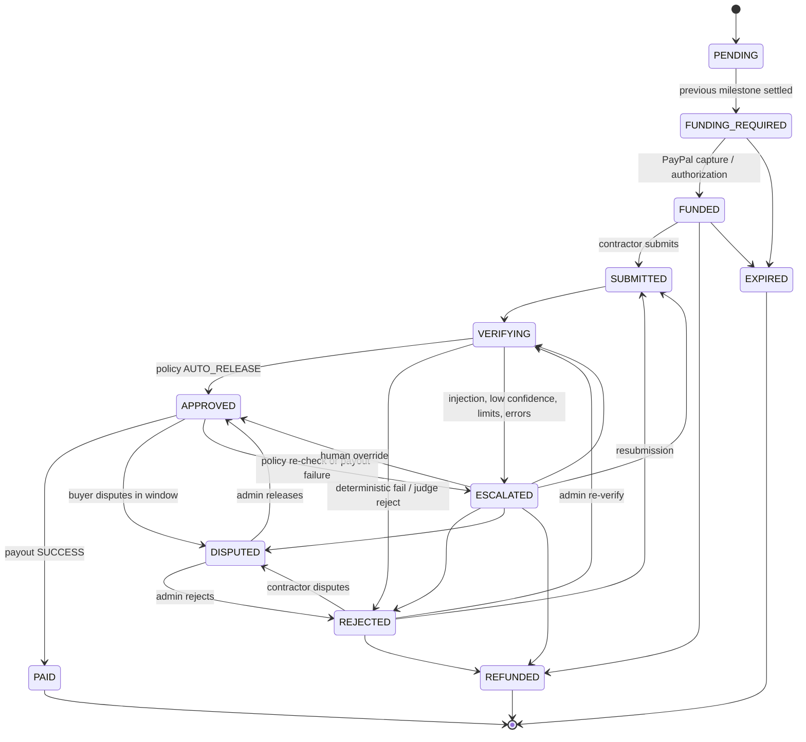
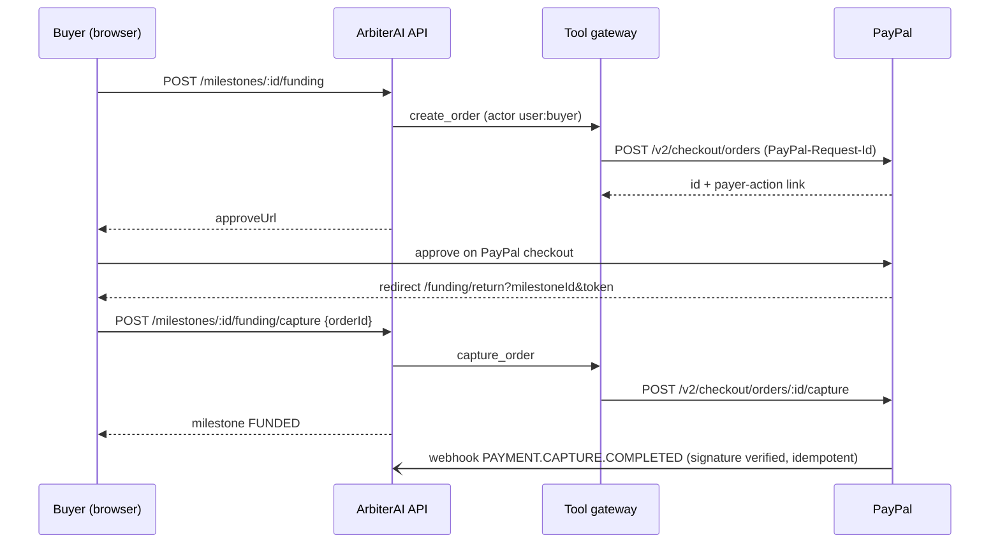
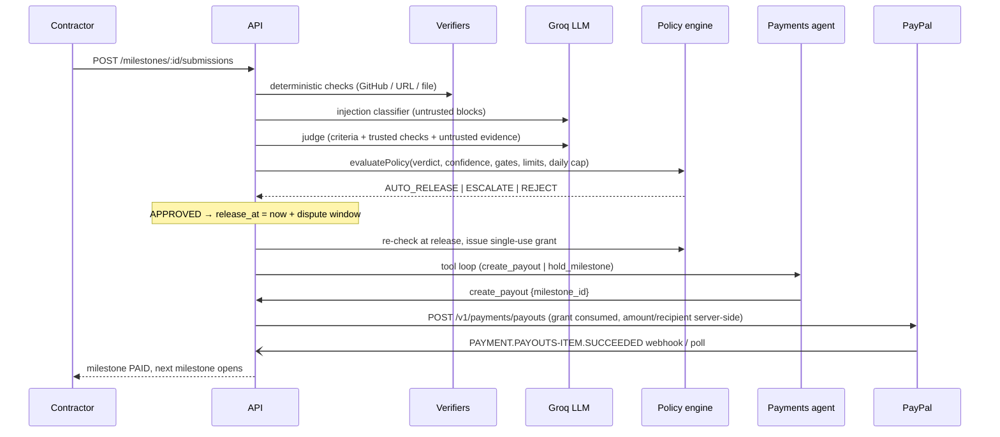

# ArbiterAI architecture

## Components

| Layer | Location | Responsibility |
|---|---|---|
| Shared contract | `shared/src` | zod schemas (contract draft, verification params, judge output, submissions), DTO types, the **milestone state machine**, permission rules, demo fixtures |
| HTTP | `backend/src/http` | Fastify plugins (demo auth, error mapping, SPA serving) and routes under `/api` |
| Services | `backend/src/services` | Contracts, funding, submissions, verification pipeline, payouts, disputes, webhooks, insights (read models), demo, scheduler, transitions |
| Agent | `backend/src/agent` | Verifiers (GitHub PR, URL, file), injection detector, LLM judge, SOW extractor, policy engine and release grants, MCP-style tool gateway, payments agent, decision log |
| Integrations | `backend/src/paypal`, `llm`, `github` | Typed PayPal REST client plus simulator; Groq client plus deterministic mock; GitHub REST plus fixtures |
| Persistence | `backend/src/db`, `repositories` | Kysely schema and migrations (SQLite or Postgres), thin repositories, row → DTO mappers |
| Realtime | `backend/src/realtime` | In-process event bus → `GET /api/events` (SSE) |
| Web | `frontend/src` | Pages, AG Grid telemetry, review console, contract builder, animations |

## Milestone state machine

Defined once in `shared/src/stateMachine.ts`. The only writer is `MilestoneTransitions.transition()`, which asserts the transition and updates the row with compare-and-set (`WHERE status = :from`), then writes an audit entry and emits an SSE event.

## Funding sequence (sandbox)

## Verification and release sequence

## Final-decision rules

1. Any deterministic **FAIL** → REJECT, or ESCALATE if the failure was an infrastructure error. Never APPROVE.
2. Injection suspected → ESCALATE (payout blocked).
3. LLM verdict REJECT → REJECT; ESCALATE → ESCALATE.
4. LLM APPROVE → the policy gate must pass every rule (confidence, auto-release limit, human-approval threshold, daily cap, no open dispute), otherwise ESCALATE.
5. At release time the policy is evaluated **again**: the daily cap and disputes may have changed.

## Data model

`users`, `contracts`, `milestones`, `submissions`, `inspections` (per-check results and evidence), `agent_decisions` (append-only, hash-chained), `payments` (order/capture/authorization/payout/refund IDs, status, fees, source, last webhook event), `webhook_events` (event id PK, verified, processed, duplicate count), `policies`, `disputes`, `release_grants`, `audit_log` (append-only).

Money is stored as integer cents and timestamps as ISO-8601 text, so the same schema works on SQLite and Postgres.

## Decision-log integrity

`hash = sha256(prev_hash + canonical_json(record_without_id_and_hash))`, starting from a zero genesis hash. Inputs are stored as a hash (`inputs_hash`) and outputs as canonical JSON. DB triggers raise on UPDATE and DELETE (SQLite `RAISE(ABORT)`, Postgres plpgsql). `GET /api/audit/verify-chain` recomputes the whole chain.

## Realtime

Services publish typed `ServerEvent`s (`milestone.updated`, `payment.updated`, `inspection.created`, `decision.created`, `webhook.received`, `agent.step`). The browser keeps one `EventSource`, pushes events to the live feed, and batch-invalidates React Query keys. AG Grid gets new row data with stable `getRowId`, so changed cells flash in place.
